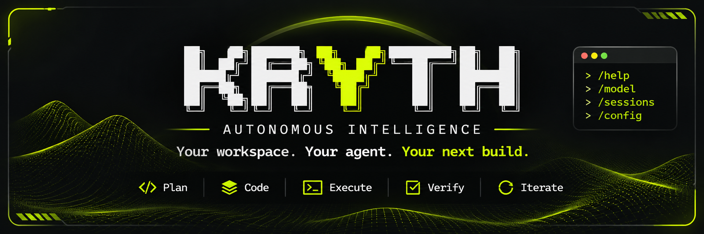

<p align="center">
  
</p>

<p align="center">
  <b>An open-source alternative AI coding agent that lives in your terminal.</b><br />
  Plans, edits, runs, and reviews code with any model on OpenRouter.
</p>

KRYTH connects to LLMs through OpenRouter, reads and edits your code with a built-in tool set, runs shell commands, delegates to specialized sub-agents, and streams everything through a full-screen TUI. Every mutating action goes through an approval policy you control, so it is as autonomous or as careful as you want it to be.

## Quick Start

Install KRYTH, connect OpenRouter, and start an agent in your own repo:

```bash
pip install kryth
kryth login    # opens your browser to authorize with OpenRouter
kryth          # start the interactive TUI
```

<p align="center">
  
</p>

## Usage

Run `kryth` from the project you want to work on, then describe your task in plain language. Start by exploring the codebase, ask for a plan, or jump into a specific change:

```text
Explain how this project is structured and where the main entry points are.
Find the cause of this failing test and fix it.
Plan a refactor of the authentication module before making any changes.
Review my changes for bugs and missing edge cases.
```

KRYTH reads the relevant files, uses its tools, and streams its progress in the terminal. When an action needs approval, you can review it before it runs. Type `/help` to see the available commands, `/model <name>` to switch models, or `/config` to inspect your configuration.

For a single task, pass your prompt directly:

```bash
kryth "Explain how this project is structured"
```

You can also choose a working directory or return to a saved conversation:

```bash
kryth --cwd /path       # run against a different working directory
kryth --continue        # pick up the last session in this directory
kryth --resume 3f2a1c   # resume a specific session by id
kryth sessions          # list saved sessions
```

Configuration lives in `~/.config/kryth/config.toml`, with per-project overrides in `.kryth/config.toml`, and `AGENTS.md` is picked up automatically.

Full [CLI reference](https://github.com/navadeep0508/Kryth/blob/main/docs/cli.md) | [configuration reference](https://github.com/navadeep0508/Kryth/blob/main/docs/configuration.md)

## Documentation

| Page | What it covers |
| --- | --- |
| [CLI reference](https://github.com/navadeep0508/Kryth/blob/main/docs/cli.md) | Installing, logging in, every command and flags |
| [Configuration](https://github.com/navadeep0508/Kryth/blob/main/docs/configuration.md) | `config.toml`, per-project overrides, `AGENTS.md`, every option |
| [Tools](https://github.com/navadeep0508/Kryth/blob/main/docs/tools.md) | The built-in tool set, sub-agents, MCP servers |
| [Approvals](https://github.com/navadeep0508/Kryth/blob/main/docs/approvals.md) | The six approval policies and the rules that override them |
| [Sessions](https://github.com/navadeep0508/Kryth/blob/main/docs/sessions.md) | Saving, resuming, checkpointing and rewinding conversations |
| [Slash commands](https://github.com/navadeep0508/Kryth/blob/main/docs/slash-commands.md) | Everything you can type after a `/` inside the TUI |
| [Architecture](https://github.com/navadeep0508/Kryth/blob/main/docs/architecture.md) | How the codebase is put together, class by class |
| [Technologies](https://github.com/navadeep0508/Kryth/blob/main/docs/technologies.md) | The libraries KRYTH is built on and what each one does |

## Why KRYTH?

- **Bring any model.** OpenRouter as the backend means versatility. One login gives you large models Claude, OpenAI, Deepseek, Kimi, and even access to smaller free models.
- **Safety is a first-class feature.** Six approval policies, dangerous-command rejection, and confirmation for anything outside the working directory. You choose the risk level, not the agent. See [Approvals](https://github.com/navadeep0508/Kryth/blob/main/docs/approvals.md).
- **It survives long sessions.** Context pruning reclaims tokens from stale tool output, and when the window fills up, KRYTH compacts history into a continuation brief and keeps going instead of erroring out.
- **Nothing is lost when you close the terminal.** Sessions are checkpointed after every turn, so `kryth --continue` puts you back exactly where you were, and `/rewind` walks the conversation back to any earlier checkpoint. See [Sessions](https://github.com/navadeep0508/Kryth/blob/main/docs/sessions.md).
- **Configurable by design.** A readable, object-oriented Python codebase built on Rich, Click, and Pydantic. Every tool is one class behind a shared abstract base, so adding a tool or a sub-agent is a small, well-marked change. See [Architecture](https://github.com/navadeep0508/Kryth/blob/main/docs/architecture.md).
- **Component-based UI design.** KRYTH uses a modular, component-based UI system with separate components for every visual element (spinners, gutters, markdown rendering, tool displays, confirmations, etc.), making it easy to maintain, customize, and extend the interface.

## What it can do

| | |
| --- | --- |
| **Files** | `read`, `write`, `edit`, `apply_patch`, `grep`, `glob`, and `list_directories` for working with a codebase. `apply_patch` batches creates, updates, deletes and renames across several files into one all-or-nothing call |
| **Bash** | The `bash` tool executes commands in the working directory. Automatically detects your OS to know what shell commands to execute  |
| **Planning** | A `plan` tool tracks steps (a to do list) across the agent loop |
| **Network and memory** | Web search via DuckDuckGo, URL fetching, and key-value storage that survives across sessions |
| **Sub-agents** | Specialized agents the main agent can delegate to: `codebase_investigator`, `code_reviewer`, `software_architect`, `test_writer`, `debugger` |
| **MCP** | Connects to external MCP servers for additional tools and data sources |
| **Skills** | Automatically checks for `SKILLS.md` files during your first prompt, bring your skills over that you've used on any other harness
| **Interactive TUI** | Full-screen terminal interface built on Rich, with streaming responses, live tool call output, visible model reasoning, and token usage tracking |
| **Single-shot mode** | Pass a prompt as an argument for non-interactive runs, suitable for scripting |

## Slash commands

| Command | What it does |
| --- | --- |
| `/help` | Show all commands |
| `/model <name>` | Switch models mid-session |
| `/approval <mode>` | Switch the approval policy mid-session |
| `/thinking [on\|off\|low\|medium\|high]` | Show, hide, or retune the model's reasoning |
| `/clear` | Start a fresh conversation (the old one stays saved) |
| `/config` | Show the active configuration |
| `/stats` | Session statistics: tokens, elapsed time, tool calls |
| `/tools` | List available tools |
| `/mcp` | Show MCP server status |
| `/sessions [all]` | List saved sessions, newest first |
| `/sessions rm <n\|id>` | Delete a saved session |
| `/resume <n\|id>` | Load a saved session into the current one |
| `/checkpoint [label]` | Save a checkpoint now, with an optional name |
| `/checkpoints` | List the checkpoints in this session |
| `/rewind <n\|id>` | Roll the conversation back to a checkpoint |
| `/exit`, `/quit` | Leave the agent |

Commands autocomplete as you type: hitting `/` lists every command, the list narrows as you keep typing, and `↑`/`↓` select while `Enter` runs the highlighted one (`Tab` fills it in if you want to add arguments first).

## Sessions

KRYTH writes the conversation to disk after every turn, so closing the terminal does not kill your conversation. All conversations are resumable and can be accessed by running a command shown below.

```bash
kryth --continue        # resume the most recent session in this directory
kryth --resume 3f2a1c   # resume a specific session (a prefix of the id is enough)
kryth sessions          # what is saved for this directory
kryth sessions --all    # every directory
kryth sessions rm 3f2a1c
```

Inside the TUI, `/sessions` lists what is saved and `/resume` loads one into the running agent, transcript and token totals included. The system prompt is not restored: it is rebuilt from the current config and tool set, so a resumed session picks up any model, approval, or `AGENTS.md` changes you have made since.

### Checkpoints

Each save is a checkpoint, a full snapshot of the conversation at that point. Turns are checkpointed automatically, and `/checkpoint <label>` marks one by hand before you try something risky:

```text
❯ /checkpoint before the refactor
Saved before the refactor · 24 messages · session 3f2a1c8b

❯ /checkpoints
1  a41f9c02  turn 3                 18 msgs  22m ago
2  7d2b1e55  turn 4                 24 msgs  4m ago
3  e0c34a91  before the refactor    24 msgs  just now

❯ /rewind 1
Rewound to turn 3 · 18 messages · turn 3
```

Rewinding replaces the conversation the model sees, which makes it the way out of a turn that went sideways: roll back to before the detour and take another run at it. **It only rewinds the conversation, not your files** — anything already written to disk stays written.

Sessions live in `~/.config/kryth/sessions/<id>/`, one directory per session, with the transcripts in a JSONL file next to a small `meta.json`. Old checkpoints are trimmed once a session passes `max_checkpoints` (autosaves go first, named ones are kept), and the oldest sessions are dropped past `max_sessions`. Set `enabled = false` under `[session]` to keep conversations off disk entirely.

## Approvals

Before KRYTH runs anything that changes state, the approval policy decides whether it goes ahead, asks you, or is refused outright. Read-only tools (`read`, `grep`, `glob`, `list_directories`, `plan`) never prompt, so a policy only affects writes, bash commands, network calls, memory writes, MCP tools, and sub-agent runs.

| Value | Badge | Behaviour |
| --- | --- | --- |
| `on_request` *(default)* | `ask` | Confirm every mutating tool call. Commands matched as known-safe (`ls`, `git status`, `grep`, …) run without asking. |
| `auto_edit` | `auto-edit` | File edits and writes inside the working directory go through unprompted; bash commands still need confirmation unless known-safe. |
| `auto` | `auto` | Everything runs except dangerous commands, which are rejected. |
| `on_fail` | `on fail` | Currently identical to `auto`. Reserved for prompting after a failed tool call, which is not implemented yet. |
| `never` | `read-only` | Rejects anything that isn't a known-safe command. Nothing gets written, and you are never prompted. |
| `yolo` | `yolo` | Approves everything, including commands matched as dangerous. Only use this in a sandbox or container. |

Two rules apply on top of the policy, and no policy except `yolo` overrides them:

- **Dangerous commands are rejected.** `rm -rf /`, `dd if=`, `mkfs`, `shutdown`, `curl … | bash`, fork bombs, and similar patterns are refused before bash ever sees them (the full list is `DANGEROUS_PATTERNS` in `safety/approval.py`).
- **Anything touching a path outside the working directory is confirmed**, however permissive the policy is (`never` rejects it instead).

## Roadmap

Currently being worked on:
- **Parallel Subagents** - allows sub-agents to call instances of other sub-agents to delegate more work to specialized agents.
- **Git Integration** - allows users to use git commands with kryth.

Have an idea? [Open an issue](https://github.com/navadeep0508/Kryth/issues), feature discussions are very welcome.

## Contributing

Contributions of every size are appreciated, from typo fixes to new tools and sub-agents. Read [CONTRIBUTING.md](https://github.com/navadeep0508/Kryth/blob/main/CONTRIBUTING.md) to get started, and check the [open issues](https://github.com/navadeep0508/Kryth/issues) for something to pick up!

If KRYTH is useful to you, **a star on the repo genuinely helps** the project reach more developers. ⭐

## License

[GNU GENERAL PUBLIC LICENSE v3.0](https://github.com/navadeep0508/Kryth/blob/main/LICENSE)
