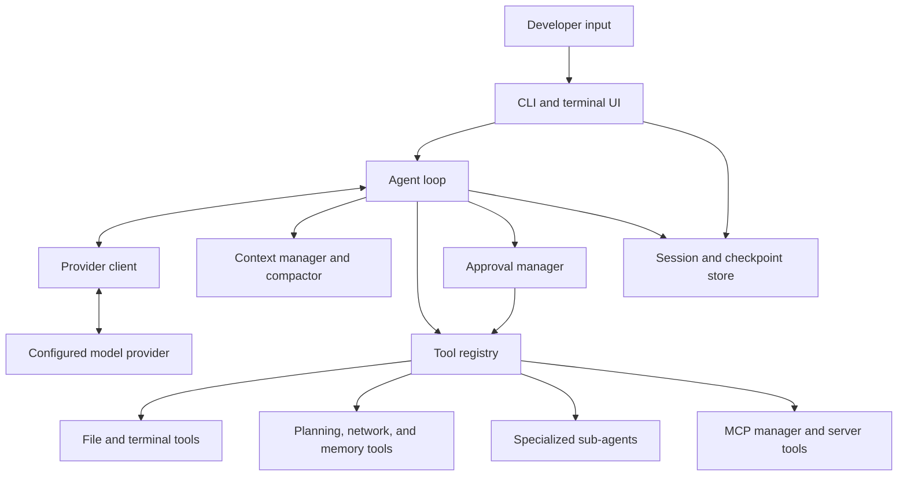

<p align="center">
  
</p>

<h1 align="center">Your Terminal. Your AI.<br />Your Autonomous Coding Agent.</h1>

<p align="center">
  KRYTH is an open-source AI coding assistant that explores codebases, plans work, edits files, and runs commands from your terminal—with approval controls and resumable sessions.
</p>

<p align="center">
  <a href="https://github.com/navadeep0508/Kryth/stargazers"></a>
  <a href="https://pypi.org/project/kryth/"></a>
  <a href="LICENSE"></a>
  <a href="https://pypi.org/project/kryth/"></a>
  <a href="https://github.com/navadeep0508/Kryth/releases/latest"></a>
</p>

<p align="center">
  <a href="#demo">Demo</a> · <a href="#install">Install</a> · <a href="#quick-start">Quick start</a> · <a href="#features">Features</a> · <a href="#documentation">Docs</a> · <a href="CONTRIBUTING.md">Contribute</a>
</p>

KRYTH is a Python terminal AI agent for developers who want an assistant to do more than answer questions. Give it a task in plain language: it can inspect your project, make a plan, call file and terminal tools, and report what it did. Its interactive terminal UI streams activity as it works; approval policies let you control when tools can make changes. OpenRouter is the default model gateway, with additional provider configurations available. Sessions and checkpoints let you continue work later. KRYTH is an open-source coding agent built to work inside the repository you choose.

## Demo

Watch KRYTH run in the terminal:

<p align="center">
  
</p>

## What is KRYTH?

KRYTH connects a language model to a codebase-aware tool loop. Instead of stopping at generated text, it can read and search project files, create or edit code, execute shell commands, use a plan, and call specialized sub-agents. You interact through a full-screen terminal UI or send a prompt directly from the CLI. Tool permissions are governed by configurable approval policies.

## Install

### Windows

The latest [GitHub release](https://github.com/navadeep0508/Kryth/releases/latest) includes the official `KRYTH-Setup-<version>.exe` installer. It installs the wheel for the current user, adds the Python Scripts directory to your user PATH, and checks the launcher. It supports installed Python 3.10–3.14 with pip and does not require administrator rights. Open a new terminal after installation.

Or install through pip:

```powershell
python -m pip install --user kryth
python -m kryth setup --path
```

If `kryth` is still not found, run `python -m kryth setup --path` using the same Python interpreter you installed with, then open a new terminal. For details, see [Windows installation](docs/installation.md).

### Linux and macOS

KRYTH requires Python 3.10 or newer, as declared in the package metadata.

```bash
python3 -m pip install kryth
```

Ensure the Python environment's scripts directory is on your `PATH`. The `setup --path` helper is Windows-only.

## Quick start

Run KRYTH from the repository you want it to work in:

```bash
cd path/to/your/project
kryth
```

On first launch, the setup flow helps configure a provider. OpenRouter is the default; KRYTH also has provider configuration for OpenAI, Anthropic, Google, Groq, NVIDIA, DeepSeek, Mistral, Together, Fireworks, Cerebras, Ollama, LM Studio, and custom OpenAI-compatible endpoints. Provider and model availability depend on your credentials and endpoint.

You can also submit a task directly or continue the latest saved session for the current directory:

```bash
kryth "Explain this codebase"
kryth --continue
```

For browser-based OpenRouter login or manual key entry, use `kryth login` or `kryth login --paste`. `API_KEY` and `BASE_URL` environment variables override saved credentials and base URL. See [configuration](docs/configuration.md) and the [CLI reference](docs/cli.md).

## Features

| Capability | What it does |
| --- | --- |
| **Autonomous coding workflow** | Runs a model/tool loop that can inspect, plan, act, and return a result. |
| **Codebase exploration** | Read files, search text, match paths, and list directories. |
| **File changes** | Write and edit files; apply multi-file patches with all-or-nothing staging. |
| **Terminal execution** | Run shell commands in the configured working directory, with environment filtering and approval checks. |
| **Planning** | Track task steps with the plan tool. |
| **Specialized sub-agents** | Delegate investigation, review, architecture, test-writing, and debugging tasks to agents with narrowed tool sets. |
| **MCP integrations** | Connect external Model Context Protocol servers over stdio or HTTP/SSE. |
| **Provider choice** | Use OpenRouter or configure supported provider profiles and compatible endpoints. |
| **Sessions and checkpoints** | Save conversations after turns, resume them, and rewind the conversation to a checkpoint. Rewind does not undo file changes. |
| **Approval policies** | Choose confirmation, edit automation, read-only, and other policies; dangerous shell patterns are checked by the safety layer. |
| **Interactive terminal UI** | See streaming responses, tool progress, diffs, plans, and slash commands in the Rich-based interface. |
| **Context management** | Prune stale tool output and compact long histories into a continuation brief. |

## See the tools and controls

| Area | Included |
| --- | --- |
| Files | `read`, `write`, `edit`, `apply_patch`, `grep`, `glob`, `list_directories` |
| Terminal | `bash` tool with shell detection, filtered environment, and approval checks |
| Planning | `plan` tool for tracking steps during a run |
| Network and memory | DuckDuckGo-backed `search`, URL `fetch`, and persistent key-value `memory` |
| Delegation | `codebase_investigator`, `code_reviewer`, `software_architect`, `test_writer`, `debugger` |
| External tools | MCP servers configured in TOML; inspect status with `/mcp` |
| Session controls | `kryth --continue`, `kryth --resume <id>`, `/checkpoint`, `/checkpoints`, `/rewind` |
| Approvals | `on_request` (default), `auto_edit`, `auto`, `on_fail`, `never`, `yolo` |
| Model settings | Configure provider, endpoint, model, reasoning, and credentials; switch model with `/model` |

See [Tools](docs/tools.md), [Approvals](docs/approvals.md), and [Sessions](docs/sessions.md) for details.

## Architecture



The diagram follows the implementation's agent, client, tool registry, approval, context, MCP, and session layers. See [Architecture](docs/architecture.md).

## Technology stack

The package declares Python `>=3.10` and these core dependency ranges in `pyproject.toml`:

| Component | Role |
| --- | --- |
| Click | CLI commands and options |
| Rich and prompt-toolkit | Terminal rendering, streaming UI, input, and completion |
| OpenAI SDK and httpx | Model API client and asynchronous HTTP |
| Pydantic | Configuration validation and tool schemas |
| FastMCP | MCP client integration |
| tiktoken | Token counting for context management |
| ddgs | DuckDuckGo-backed web search |
| platformdirs | Cross-platform user configuration paths |

See [Technologies](docs/technologies.md) and [pyproject.toml](pyproject.toml) for the full dependency list and version ranges.

## Configuration

KRYTH reads user settings from `~/.config/kryth/config.toml` (resolved through `platformdirs`) and optional project overrides from `.kryth/config.toml`. `AGENTS.md` instructions are discovered from the working directory up to the repository root. Configure provider/model settings, approval policy, sessions, MCP servers, hooks, and the command environment in TOML.

Credentials can be entered through `kryth login` or the setup flow. `API_KEY` and `BASE_URL` take precedence over stored values; avoid committing secrets in project config. The complete schema and examples are in [Configuration](docs/configuration.md).

## Documentation

| Guide | Description |
| --- | --- |
| [Windows installation](docs/installation.md) | Installer, pip, PATH setup, and recovery |
| [CLI reference](docs/cli.md) | Commands, flags, login, and keyboard shortcuts |
| [Configuration](docs/configuration.md) | TOML settings, providers, environment variables, hooks, MCP, and `AGENTS.md` |
| [Tools](docs/tools.md) | Built-in tools, sub-agents, MCP, and context handling |
| [Approvals](docs/approvals.md) | Approval policies and safety checks |
| [Sessions](docs/sessions.md) | Session storage, resume, checkpoints, and rewind |
| [Slash commands](docs/slash-commands.md) | Commands available inside the TUI |
| [Architecture](docs/architecture.md) | Project structure and implementation design |
| [Technologies](docs/technologies.md) | Libraries and their roles |
| [Brand guide](docs/brand.md) | Existing KRYTH brand assets and guidance |
| [Publishing](docs/publishing.md) | Project release and publishing notes |

## Roadmap

The project currently lists these items as **in progress** in the existing README:

- **Parallel sub-agents** — allow sub-agents to delegate work to other specialized sub-agents.
- **Git integration** — add dedicated Git functionality to KRYTH.

These are planned work, not capabilities advertised above. See [open issues](https://github.com/navadeep0508/Kryth/issues) for current discussion and status.

## Contributing

Contributions are welcome. To get a development checkout:

```bash
git clone https://github.com/navadeep0508/Kryth.git
cd Kryth
uv sync
```

Alternatively, install the project in editable mode with `python -m pip install -e .`. Run the existing test suite with `uv run pytest`. Fork the repository, make a focused branch, and open a pull request against `main` with a clear description. See [CONTRIBUTING.md](CONTRIBUTING.md) for workflow and UI contribution guidance.

## Community and support

- Report bugs or request features through [GitHub Issues](https://github.com/navadeep0508/Kryth/issues).
- For proposed changes, open a [pull request](https://github.com/navadeep0508/Kryth/pulls).
- Contributions follow the [Code of Conduct](CODE_OF_CONDUCT.md).

## License

KRYTH is licensed under the [GNU General Public License v3.0 or later](LICENSE).

---

If KRYTH is useful to you, consider [giving the repository a star](https://github.com/navadeep0508/Kryth/stargazers). It helps more developers discover the project.
